# Victor Costa

**Senior Full Stack Developer · Tech Lead · Ruby on Rails · React · TypeScript · Python**

I build web applications from data models and APIs to user interfaces and production diagnostics. Developing software professionally since 2017, I combine hands-on implementation with architectural decisions, code review and responsibility for delivery.

  
  

**[Explore my work](https://victorcorcos.pages.dev/en/work/)** · [Services](https://victorcorcos.pages.dev/en/services/) · [Email](mailto:victorcorcos.labs@gmail.com) · [LinkedIn](https://www.linkedin.com/in/victorcorcos) · [WhatsApp](https://wa.me/5571997053401)

## What I bring to a team

- **Backend ownership:** I defined and implemented an entire Rails backend foundation, including data modeling and APIs, then led its continued development with a team.
- **Full stack leadership:** I served as the main technical lead while contributing directly to backend, frontend and automated tests, overseeing technical decisions, quality and deadlines.
- **Integration and diagnostics:** I took full technical responsibility for an API integration backend and built its diagnostic interface, from understanding contracts to implementation and verification.
- **Engineering knowledge:** I created three published Ruby gems and delivered talks on Clean Code and BDD at UFBA. I work directly with international teams and clients in English.

## Explore my engineering work

- [Backend architecture](https://victorcorcos.pages.dev/en/work/configurable-backends/): my responsibilities, modeling trade-offs and an independent configuration example.
- [API integration and diagnostics](https://victorcorcos.pages.dev/en/work/api-integration/): technical ownership and an animated teaching example of data flow and verification.
- [React modernization](https://victorcorcos.pages.dev/en/work/react-modernization/): my experience and an interactive comparison of asynchronous workflows.

## Public code

- **[wisetree](https://github.com/Victorcorcos/wisetree)**: an independent Rust terminal tool for managing Git worktrees.
- **[hierarchy-tree](https://github.com/Victorcorcos/hierarchy-tree)**: Rails association traversal, hierarchies and paths.
- **[validations-skipper](https://github.com/victorcorcos/validations-skipper)**: selective validation control per instance.
- **[cascade-deleter](https://github.com/victorcorcos/cascade-deleter)**: configurable deletion of records and descendants.
- **[clean-code](https://github.com/Victorcorcos/clean-code)**: principles and practical examples for readable, maintainable code.

**Core:** Ruby on Rails, React, TypeScript, REST, GraphQL, automated testing and BDD.

**Also worked with:** SQL and NoSQL databases, Redis, Kafka, AWS ECS/S3/SQS/SNS, Docker, observability, C/C++ and Rust.

Computer Science graduate from **UFBA**, with an exchange year at **SUNY Plattsburgh, USA**.

For Senior Full Stack Development, hands-on technical leadership, consulting or developer training, **[let’s talk](mailto:victorcorcos.labs@gmail.com)**.

Leia em português

## Victor Costa

**Senior Full Stack Developer & Tech Lead · Ruby on Rails · React · TypeScript**

Desenvolvo aplicações web, da modelagem de dados e APIs às interfaces e ao diagnóstico em produção. Trabalho profissionalmente com desenvolvimento desde 2017, combinando implementação, decisões de arquitetura, revisão de código e responsabilidade pela entrega.

**[Conheça meu trabalho](https://victorcorcos.pages.dev/pt/projetos/)** · [Serviços](https://victorcorcos.pages.dev/pt/servicos/) · [Email](mailto:victorcorcos.labs@gmail.com) · [LinkedIn](https://www.linkedin.com/in/victorcorcos) · [WhatsApp](https://wa.me/5571997053401)

### O que levo para uma equipe

- **Responsabilidade pelo backend:** defini e implementei toda a base de um backend Rails, incluindo modelagem de dados e APIs. Depois liderei sua evolução em equipe.
- **Liderança full stack:** fui o principal líder técnico e participei diretamente do backend, frontend e testes automatizados, acompanhando decisões técnicas, qualidade e prazos.
- **Integração e diagnóstico:** assumi toda a responsabilidade técnica pelo backend de uma integração de APIs e criei sua interface de diagnóstico, do estudo dos contratos à implementação e verificação.
- **Conhecimento de engenharia:** criei três gems Ruby publicadas e apresentei palestras sobre Clean Code e BDD na UFBA. Trabalho diretamente com equipes e clientes internacionais em inglês.

### Conheça meu trabalho de engenharia

- [Arquitetura de backends](https://victorcorcos.pages.dev/pt/projetos/backends-configuraveis/): minhas responsabilidades, critérios de modelagem e um exemplo independente de configuração.
- [Integração de APIs e diagnóstico](https://victorcorcos.pages.dev/pt/projetos/integracao-apis/): responsabilidade técnica e um exemplo didático animado de fluxo e verificação dos dados.
- [Modernização React](https://victorcorcos.pages.dev/pt/projetos/modernizacao-react/): minha experiência e uma comparação interativa de fluxos assíncronos.

### Código público

- **[wisetree](https://github.com/Victorcorcos/wisetree)**: ferramenta independente de terminal em Rust para gerenciar worktrees do Git.
- **[hierarchy-tree](https://github.com/Victorcorcos/hierarchy-tree)**: travessia de associações Rails, hierarquias e caminhos.
- **[validations-skipper](https://github.com/victorcorcos/validations-skipper)**: controle seletivo de validações por instância.
- **[cascade-deleter](https://github.com/victorcorcos/cascade-deleter)**: exclusão configurável de registros e descendentes.
- **[clean-code](https://github.com/Victorcorcos/clean-code)**: princípios e exemplos práticos para código legível e sustentável.

**Foco principal:** Ruby on Rails, React, TypeScript, REST, GraphQL, testes automatizados e BDD.

**Também trabalhei com:** bancos SQL e NoSQL, Redis, Kafka, AWS ECS/S3/SQS/SNS, Docker, observabilidade, C/C++ e Rust.

Bacharel em Ciência da Computação pela **UFBA**, com intercâmbio na **SUNY Plattsburgh, EUA**.

Para Desenvolvimento Full Stack Sênior, liderança técnica com atuação no código, consultoria ou capacitação de desenvolvedores, **[vamos conversar](mailto:victorcorcos.labs@gmail.com)**.

